<div align="center">

<a href="https://app.relatch.online">
  
</a>

<br />
<br />

<a href="https://react.dev"></a>
<a href="https://www.typescriptlang.org"></a>
<a href="https://vite.dev"></a>
<a href="https://tailwindcss.com"></a>
<a href="https://gsap.com"></a>
<a href="https://clerk.com"></a>
<a href="https://mozilla.github.io/pdf.js/"></a>
<a href="https://vercel.com"></a>

<a href="https://app.relatch.online"></a>
<a href="https://github.com/pausevolve-wq/Relatch-fe/commits"></a>


<br />
<br />

**[Open the app](https://app.relatch.online)** &nbsp;·&nbsp; [relatch.online](https://relatch.online) &nbsp;·&nbsp; [How it works](#how-it-works) &nbsp;·&nbsp; [Inside the app](#inside-the-app) &nbsp;·&nbsp; [Design language](#design-language) &nbsp;·&nbsp; [Run it locally](#run-it-locally) &nbsp;·&nbsp; [Backend](https://github.com/pausevolve-wq/relatch)

</div>

<br />

## Relatch, in one breath

Relatch is **the context compiler**. You give it the documents you already have (a style guide, a codebase walkthrough, a pricing sheet, your own writing) and it gives back a **skill**: a structured file that teaches an AI agent how to work the way those documents describe. One click installs it in **Claude**, **Codex**, or **any agent that reads skills**.

This repository is the web app at [app.relatch.online](https://app.relatch.online): a single-page React application that reads your documents **in the browser**, streams Relatch's reasoning to the screen while it works, and packages the result in the right format for the agent you picked. The compiling itself happens server side, in the [Relatch API](https://github.com/pausevolve-wq/relatch).

> [!NOTE]
> **Your documents stay yours.** Text is extracted in the browser. Only scanned PDFs that have no usable text layer are sent for OCR. Relatch keeps the finished skill in your history when you are signed in, and **never the source document, its file name, or its extracted text**.

<br />

## How it works

<div align="center">
  
</div>

| | Step | What happens | Where |
|:-:|---|---|---|
| **01** | **Drop** | Up to three documents per skill: `.pdf` `.docx` `.doc` `.md` `.txt` `.csv` `.html` `.xml` `.json` `.yaml` `.toml` and source files (`.js` `.ts` `.py` `.rb` `.go` `.rs`). The picker offers exactly what the engine accepts. | Browser |
| **02** | **Read** | PDF.js and a DOCX reader pull the text out locally. A structural check spots scans with a weak text layer, and only those escalate to OCR. | Browser, OCR for scans only |
| **03** | **Compile** | The API works out what the skill is for, picks the right shape for it, writes it and verifies it before it comes back. | [Relatch API](https://github.com/pausevolve-wq/relatch) |
| **04** | **Watch** | A live reasoning panel shows real steps (read, profiled, sent, written), each backed by something the engine actually knows at that moment. Afterwards it folds into *Thought for 6.3s*. | Browser |
| **05** | **Install** | Download a Claude `.md`, a Codex ZIP (`SKILL.md` + `agents/openai.yaml`) or an Agents folder, then follow a short animated walkthrough for that agent. | Browser |

Three documents added within the same few minutes count as **one skill set**: you can fetch the document you forgot after the first one has already started, and it does not cost a second skill.

<br />

## Inside the app

<div align="center">
  
</div>

V3 is **one page that changes state** rather than a wizard of routes. The job card starts as a thinking panel, then widens and grows into the skill preview, and nothing ever jumps to a new screen.

| Layer | What lives there | Key files |
|---|---|---|
| **Entry** | The HTML shell, the React root and the analytics bootstrap (loaded first, so the first page view is never lost). | [`v3.html`](Relatch-fe-main/v3.html) · [`src/v3/main.tsx`](Relatch-fe-main/src/v3/main.tsx) · [`src/analytics.ts`](Relatch-fe-main/src/analytics.ts) |
| **Shell** | An error boundary *outside* auth, so any crash shows a designed screen and never a blank page. Then Clerk, then the app. | [`ErrorScreens.tsx`](Relatch-fe-main/src/v3/ErrorScreens.tsx) · [`V3App.tsx`](Relatch-fe-main/src/v3/V3App.tsx) |
| **Scenes** | The intro and drop zone, the job card, the reasoning panel, the history rail, install walkthroughs, the sign-up sheet. | [`Start.tsx`](Relatch-fe-main/src/v3/Start.tsx) · [`JobStage.tsx`](Relatch-fe-main/src/v3/JobStage.tsx) · [`Thinking.tsx`](Relatch-fe-main/src/v3/Thinking.tsx) · [`Sidebar.tsx`](Relatch-fe-main/src/v3/Sidebar.tsx) |
| **State** | Hooks own the logic and components stay presentational. `useSkillJob` runs a set of up to three documents through the engine and turns its progress events into reasoning steps. | [`useSkillJob.ts`](Relatch-fe-main/src/v3/useSkillJob.ts) · [`useSkillHistory.ts`](Relatch-fe-main/src/v3/useSkillHistory.ts) · [`usePlan.ts`](Relatch-fe-main/src/v3/usePlan.ts) |
| **Engine** | Framework-free TypeScript: validation, local text extraction, document profiling, the API client, and packaging for each target. | [`engine/core.ts`](Relatch-fe-main/src/engine/core.ts) · [`skillExport.ts`](Relatch-fe-main/src/v3/skillExport.ts) |
| **Edges** | The Relatch API, Clerk (Google, GitHub, email), Cloudflare Turnstile for the free try, PostHog for product analytics. | [`auth/`](Relatch-fe-main/src/v3/auth) · [`turnstile.ts`](Relatch-fe-main/src/v3/turnstile.ts) |

<details>
<summary><b>A few decisions worth knowing about</b></summary>
<br />

- **Model output is never injected as HTML.** [`SkillMarkdown.tsx`](Relatch-fe-main/src/v3/SkillMarkdown.tsx) typesets a skill block by block, and every piece of text becomes a React text node, so nothing inside a generated skill can run or inject markup.
- **The free try works without an account.** A visitor passes an invisible bot check, gets a short-lived trial token, and sees a preview of their skill. Signing up unlocks the full skill they already made, with no second run.
- **Downloads cannot break across deploys.** JSZip is bundled statically rather than lazy-loaded, because a tab opened before a deploy would otherwise ask for a renamed chunk and silently fail to download.
- **Real 404s.** The build copies the app shell to `404.html`, so unknown addresses still show the designed Not Found screen while bots and stale links get a genuine `404` status.
- **Foldables are a first-class case.** [`useUnfold.ts`](Relatch-fe-main/src/v3/useUnfold.ts) tells a phone unfolding apart from a rotation or a window resize, and re-lays the page out properly.

</details>

<br />

## The mark is alive

<div align="center">
  
</div>

The Relatch mark is four latch pieces around a square centre, and it behaves like the product does. [`RelatchMark.tsx`](Relatch-fe-main/src/v3/RelatchMark.tsx) drives it with GSAP: a slow breath at rest, *part, turn a quarter, close* while Relatch reasons, and one firm latch when the skill is ready.

On the sign-up sheet the mark becomes a character. [`MarkBuddy.tsx`](Relatch-fe-main/src/v3/auth/MarkBuddy.tsx) puts two eyes in the window where the pieces meet and gives them a body:

| Mood | When | What it does |
|---|---|---|
| `idle` | Nothing to do | Breathes, follows your pointer, glances around on its own after 2.5 s of stillness |
| `watch` | You are typing | The latch opens a little and the eyes follow the text cursor |
| `shut` | Password field | The latch closes to the logo's own shape and the eyes shut, looking politely away |
| `doubt` | The email looks wrong | The latch tightens and one eye narrows more than the other |
| `busy` | Checking a code | The product's own thinking turn |
| `eager` / `glee` | Unlocking a skill | Wide open with a bob, then both eyes squint up in a smile |

The eyes sit on a small virtual sphere, so an eye heading for the rim narrows and fades as a real one would. A three-sine wander means they never repeat and never freeze, and blinks close fast and open slow, sometimes twice. The animated mark at the top of this page is a frame-by-frame port of that same maths, baked into the SVG because a README cannot run JavaScript.

<br />

## Design language

<div align="center">
  
</div>

- **Light is the only accent.** Dark and monochrome throughout: soft white glows on black and no brand colour. Tokens live in [`v3.css`](Relatch-fe-main/src/v3/v3.css) as Tailwind 4 `@theme` variables.
- **Satoshi** for everything you read (bundled, 400/500/700), **Geist Mono** for code, labels and numbers.
- **Motion has a job.** Things arrive fast and settle slowly (`cubic-bezier(0.16, 1, 0.3, 1)`). Every animation respects `prefers-reduced-motion`.
- **Measured, not guessed.** Gutters, header wrapping and phone layouts were checked at every width from 280 px up, with scripted tests behind them.

<br />

## Tech stack

| | |
|---|---|
| **UI** | React 19 · TypeScript 5.9 (strict) · Tailwind CSS 4 · GSAP 3 with `@gsap/react` · Phosphor and Lucide icons |
| **Build** | Vite 7 with `@vitejs/plugin-react` · esbuild · a single `v3.html` entry |
| **Auth** | Clerk (`@clerk/react`): Google, GitHub and email, with a custom dark appearance |
| **Documents** | `pdfjs-dist` for PDFs · JSZip for DOCX reading and skill packaging · `file-saver` |
| **Trust** | Cloudflare Turnstile for the free try · an enforced Content-Security-Policy |
| **Analytics** | PostHog, identified after sign-in. Document names are never sent. |
| **Hosting** | Vercel, with security headers and rewrites in [`vercel.json`](Relatch-fe-main/vercel.json) |

<br />

## Project structure

<details open>
<summary><b>The parts that matter</b></summary>

```text
Relatch-fe-main/
├── v3.html                  the page Vercel serves at every app address
├── vite.config.ts           single V3 entry, @ alias, the real-404 copy step
├── vercel.json              CSP + security headers, app-address rewrites
├── public/                  icons, Open Graph image, robots.txt, sitemap
└── src/
    ├── analytics.ts         PostHog bootstrap, imported first
    ├── engine/core.ts       validation, extraction, profiling, API client
    ├── lib/utils.ts         cn() and small helpers
    └── v3/
        ├── main.tsx         React root: error boundary → Clerk → app
        ├── V3App.tsx        the one page and its states
        ├── Start.tsx        intro, Claude / Codex / Agents switch, drop zone
        ├── JobStage.tsx     the job card that becomes the skill preview
        ├── Thinking.tsx     the live reasoning panel
        ├── Sidebar.tsx      your skills, newest first
        ├── RelatchMark.tsx  the living mark
        ├── auth/            sign-up sheet, MarkBuddy, Clerk wiring, SSO callback
        ├── use*.ts          hooks: job, history, plan, identify, unfold
        ├── skillExport.ts   Claude .md · Codex ZIP · Agents folder
        └── v3.css           design tokens and the few hand-written styles
```

`index.html`, `src/main.tsx` and `src/App.tsx` are the previous (V2) app. They stay in the repo as a rollback path and are **not built**.

</details>

<br />

## Run it locally

**Prerequisites:** Node.js **20.19+** or **22.12+** (Vite 7's floor) and a Clerk publishable key.

```bash
cd Relatch-fe-main
npm install

# .env.local
VITE_CLERK_PUBLISHABLE_KEY=pk_test_...

npm run dev        # then open http://localhost:5173/v3.html
npm run build      # production build into dist/
npm run preview    # serve the build locally
```

> [!IMPORTANT]
> In development, `/` still serves the legacy `index.html`. **Open `/v3.html`** to get the current app.
>
> The app talks to the production Relatch API, which only accepts requests from `app.relatch.online`. Locally, every screen, the sign-up flow and in-browser extraction all work, but compiling a skill end to end needs the deployed origin.

<br />

## Deployment

Every merge to `main` deploys to Vercel. [`vercel.json`](Relatch-fe-main/vercel.json) rewrites the app's own addresses to `v3.html`, sends everything else to the real 404 page, and sets the security headers on every response:

`Content-Security-Policy` (allow-listed script, connect and frame origins, `frame-ancestors 'none'`) · `X-Frame-Options: DENY` · `X-Content-Type-Options: nosniff` · `Referrer-Policy: strict-origin-when-cross-origin` · `Permissions-Policy` with camera, microphone and geolocation off.

A new app address has to be added to **both** the rewrite list and the app's own address list, or it will 404 by design.

<br />

## Credits

- Eye tracking in `MarkBuddy` is adapted from [signup-buddy](https://github.com/Logiaweb/signup-buddy) by Adrien Ninet (MIT), itself adapted from Bencho's eye tracker (MIT). Full notices: [`THIRD_PARTY_NOTICES.md`](Relatch-fe-main/src/v3/auth/THIRD_PARTY_NOTICES.md).
- [Satoshi](https://www.fontshare.com/fonts/satoshi) by Indian Type Foundry · [Geist Mono](https://vercel.com/font) by Vercel (OFL).

## Licence

Copyright © 2026 Relatch. **All rights reserved.** The source is public so you can see how the app is built. It is not open source, and no licence to reuse it is granted.

<br />

<div align="center">
  <a href="https://relatch.online"></a>
</div>
